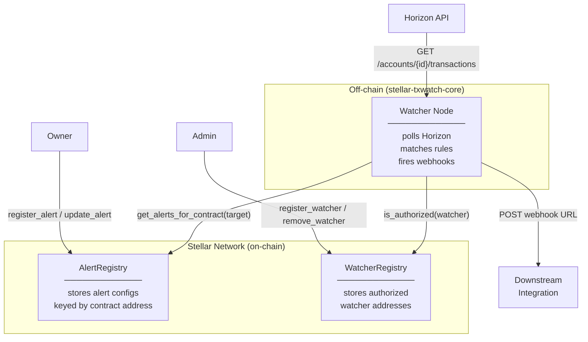

# stellar-txwatch-contracts

Soroban smart contracts for on-chain alert configuration storage and watcher registry.  
Part of the [Tx-wat](https://github.com/Tx-wat) organization.

## Contracts

| Contract | Description |
|---|---|
| [Alert Registry](contracts/alert-registry/src/lib.rs) | Stores alert configs on-chain keyed by contract address |
| [Watcher Registry](contracts/watcher-registry/src/lib.rs) | Stores authorized watcher node addresses |

## Quick Start

```bash
# Install Rust + Soroban target
curl --proto '=https' --tlsv1.2 -sSf https://sh.rustup.rs | sh
rustup target add wasm32-unknown-unknown

# Build
cargo build --release --target wasm32-unknown-unknown

# Test
cargo test

# Generate TypeScript bindings
make bindings
```

## Deploying Contracts

Use `scripts/deploy.sh` to deploy both contracts to a target network. The script is
idempotent: if a contract is already deployed it skips the upload/deploy step and
runs a post-deploy health check to confirm the contract is callable.

Required environment variables (documented at the top of the script):

| Variable | Description |
|---|---|
| `NETWORK` | Target network: `testnet` or `mainnet` |
| `SOURCE` | Stellar CLI identity used to sign the deploy |
| `ALERT_REGISTRY_ID` | Existing AlertRegistry contract ID (optional; enables idempotency check) |
| `WATCHER_REGISTRY_ID` | Existing WatcherRegistry contract ID (optional; enables idempotency check) |

```bash
# Deploy to testnet
NETWORK=testnet SOURCE=my-identity ./scripts/deploy.sh

# Re-run against an existing deployment (skips upload, verifies health)
NETWORK=testnet SOURCE=my-identity \
  ALERT_REGISTRY_ID=<ALERT_REGISTRY_CONTRACT_ID> \
  WATCHER_REGISTRY_ID=<WATCHER_REGISTRY_CONTRACT_ID> \
  ./scripts/deploy.sh
```

If a deploy partially fails, the script exits non-zero (via `set -euo pipefail`).
Re-run the script with the contract IDs that were successfully deployed set in the
environment — the idempotency check will skip those and retry only the remaining
contracts. No on-chain rollback is required; a failed deploy leaves no contract
behind, so re-running is safe.

## Verifying a Deployment

After deploying, run `scripts/verify.sh` to validate the deployed contract state.
The script accepts a `--network` flag (`testnet` or `mainnet`) and exits `0` only
if every check passes. It verifies:

1. Both contracts are deployed and accessible.
2. `AlertRegistry.get_admin` returns a valid address.
3. `WatcherRegistry.get_admins` returns at least one address.
4. A round-trip test: register an alert, retrieve it, then remove it.
5. `is_authorized` returns `false` for a random address (registry is not compromised).
6. The deployed WASM hash matches the expected value from `DEPLOYMENTS.md`.

```bash
# Verify a testnet deployment
./scripts/verify.sh --network testnet

# Verify a mainnet deployment
./scripts/verify.sh --network mainnet
```

Each check prints a clear `PASS`/`FAIL` line so you can see exactly which checks
succeeded and which failed. Contract IDs and the signing identity are read from
the same environment variables used by `scripts/deploy.sh` (`ALERT_REGISTRY_ID`,
`WATCHER_REGISTRY_ID`, `SOURCE`).

## TypeScript Bindings

TypeScript bindings for the AlertRegistry contract are available on npm:

```bash
npm install @tx-wat/alert-registry-bindings
```

See [bindings/alert-registry/README.md](bindings/alert-registry/README.md) for usage examples.

To generate bindings locally:

```bash
make bindings
```

## Architecture



**Data flow:**

1. An owner registers an alert in `AlertRegistry` — specifying the target contract, rules, and a hashed webhook URL.
2. Authorized watcher nodes are recorded in `WatcherRegistry` by an admin.
3. A watcher node polls Horizon for transaction activity, fetches matching alert configs from `AlertRegistry`, and checks whether any rule matches.
4. On a match the watcher fires the configured webhook so downstream integrations can react.

---

## How it works

The system is centered around three data-flow steps:

1. An owner registers an alert in `AlertRegistry` with the contract address, labels, webhook hash, and rules.
2. Authorized watcher nodes poll Horizon for transaction activity, then check the stored alert definitions in `AlertRegistry` to determine whether a watched contract event matches.
3. When a match is found, the watcher fires the configured webhook so downstream integrations can react.

This keeps alert configuration on-chain while letting watcher nodes perform off-chain polling and delivery.

## Stellar Integration

### Network Configuration

```toml
# Testnet
rpc_url       = "https://soroban-testnet.stellar.org"
passphrase    = "Test SDF Network ; September 2015"
horizon_url   = "https://horizon-testnet.stellar.org"

# Mainnet
rpc_url       = "https://mainnet.stellar.validationcloud.io/v1/<API_KEY>"
passphrase    = "Public Global Stellar Network ; September 2015"
horizon_url   = "https://horizon.stellar.org"
```

### Invoking Contracts (Stellar CLI)

```bash
# Register a watcher (admin only)
stellar contract invoke \
  --id <WATCHER_REGISTRY_CONTRACT_ID> \
  --source <ADMIN_IDENTITY> \
  --network testnet \
  -- register_watcher \
  --admin <ADMIN_ADDRESS> \
  --watcher <WATCHER_ADDRESS>

# Register an alert config
stellar contract invoke \
  --id <ALERT_REGISTRY_CONTRACT_ID> \
  --source <OWNER_IDENTITY> \
  --network testnet \
  -- register_alert \
  --owner <OWNER_ADDRESS> \
  --target_contract <WATCHED_CONTRACT_ADDRESS> \
  --label "My Alert" \
  --webhook_hash "<sha256-of-webhook-url>" \
  --rules '["rule:transfer","rule:mint"]'

# Query alerts for a contract
stellar contract invoke \
  --id <ALERT_REGISTRY_CONTRACT_ID> \
  --network testnet \
  -- get_alerts_for_contract \
  --target_contract <WATCHED_CONTRACT_ADDRESS>
```

### Invoking Contracts (JavaScript SDK)

```js
import {
  Contract,
  SorobanRpc,
  TransactionBuilder,
  Networks,
  BASE_FEE,
  nativeToScVal,
  Address,
} from "@stellar/stellar-sdk";

const server = new SorobanRpc.Server("https://soroban-testnet.stellar.org");
const contract = new Contract("<ALERT_REGISTRY_CONTRACT_ID>");

// Build a register_alert transaction
const account = await server.getAccount(ownerKeypair.publicKey());
const tx = new TransactionBuilder(account, {
  fee: BASE_FEE,
  networkPassphrase: Networks.TESTNET,
})
  .addOperation(
    contract.call(
      "register_alert",
      new Address(ownerKeypair.publicKey()).toScVal(),          // owner
      new Address("<WATCHED_CONTRACT_ADDRESS>").toScVal(),      // target_contract
      nativeToScVal("My Alert", { type: "string" }),            // label
      nativeToScVal("<sha256-of-webhook-url>", { type: "string" }), // webhook_hash
      nativeToScVal(["rule:transfer", "rule:mint"], { type: "array", element: { type: "string" } }), // rules
    )
  )
  .setTimeout(30)
  .build();

const preparedTx = await server.prepareTransaction(tx);
preparedTx.sign(ownerKeypair);
const result = await server.sendTransaction(preparedTx);
console.log("Transaction hash:", result.hash);
```

```js
import {
  Contract,
  SorobanRpc,
  TransactionBuilder,
  Networks,
  BASE_FEE,
  Address,
} from "@stellar/stellar-sdk";

const server = new SorobanRpc.Server("https://soroban-testnet.stellar.org");
const contract = new Contract("<WATCHER_REGISTRY_CONTRACT_ID>");

// Initialize the registry (one-time, admin only)
const account = await server.getAccount(adminKeypair.publicKey());
const initTx = new TransactionBuilder(account, {
  fee: BASE_FEE,
  networkPassphrase: Networks.TESTNET,
})
  .addOperation(
    contract.call(
      "initialize",
      new Address(adminKeypair.publicKey()).toScVal(), // admin
    )
  )
  .setTimeout(30)
  .build();

const preparedInit = await server.prepareTransaction(initTx);
preparedInit.sign(adminKeypair);
await server.sendTransaction(preparedInit);

// Register a watcher node (admin only)
const account2 = await server.getAccount(adminKeypair.publicKey());
const registerTx = new TransactionBuilder(account2, {
  fee: BASE_FEE,
  networkPassphrase: Networks.TESTNET,
})
  .addOperation(
    contract.call(
      "register_watcher",
      new Address(adminKeypair.publicKey()).toScVal(),   // admin
      new Address("<WATCHER_NODE_ADDRESS>").toScVal(),   // watcher
    )
  )
  .setTimeout(30)
  .build();

const preparedRegister = await server.prepareTransaction(registerTx);
preparedRegister.sign(adminKeypair);
await server.sendTransaction(preparedRegister);
```
